  
  
  

---

## 👨‍💻 About Me

I'm a **MERN Stack developer from Pakistan 🇵🇰** who enjoys turning ideas into clean, working web applications. I recently **completed my final-year project** and am now expanding my skill set into **DevOps and Cloud** to become a job-ready Full Stack + DevOps Engineer.

- 🎓 **Recently completed:** Final Year Project ✅
- 🌱 **Currently learning:** Docker, Linux, AWS, CI/CD
- 💼 **Core stack:** React.js, Node.js, Express.js, MongoDB, JavaScript
- 🎯 **Goal:** Full Stack + DevOps Engineer
- 📍 **Location:** Pakistan
- 🤝 **Open to:** Internships, junior roles, and collaboration on open-source projects

---

## 🛠️ Tech Stack

**Frontend**

**Backend & Database**

**DevOps, Cloud & Tools** *(learning)*

---

## 🗺️ My Learning Journey

```mermaid
flowchart LR
    A["HTML · CSS · JS"] --> B["React.js"]
    B --> C["Node · Express · MongoDB"]
    C --> D["Final Year Project ✅"]
    D --> E["Linux"]
    E --> F["Docker"]
    F --> G["AWS"]
    G --> H["CI/CD"]
    H --> I["🎯 Full Stack + DevOps Engineer"]

    style D fill:#238636,stroke:#2ea043,color:#fff
    style E fill:#1F6FEB,stroke:#58A6FF,color:#fff
    style F fill:#1F6FEB,stroke:#58A6FF,color:#fff
    style G fill:#1F6FEB,stroke:#58A6FF,color:#fff
    style H fill:#1F6FEB,stroke:#58A6FF,color:#fff
    style I fill:#8957E5,stroke:#A371F7,color:#fff
```

---

## 🐍 Contribution Snake

<picture>
  <source media="(prefers-color-scheme: dark)" srcset="https://raw.githubusercontent.com/Nadeem4054/Nadeem4054/output/github-snake-dark.svg" />
  <source media="(prefers-color-scheme: light)" srcset="https://raw.githubusercontent.com/Nadeem4054/Nadeem4054/output/github-snake.svg" />
  
</picture>

---

## 📊 GitHub Analytics

---

## 🏆 GitHub Trophies

---

## 📫 Let's Connect

I'm always happy to talk about web development, DevOps, or new opportunities.

---

⭐ **Learning every day. Building every day. Becoming better every day.**

